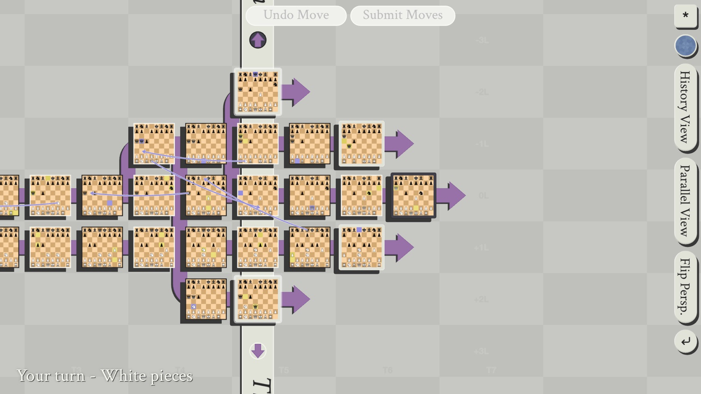
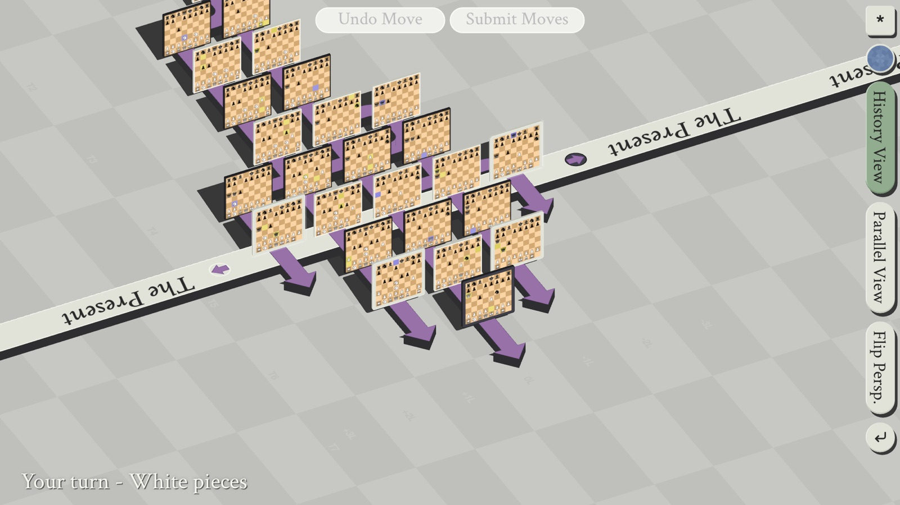
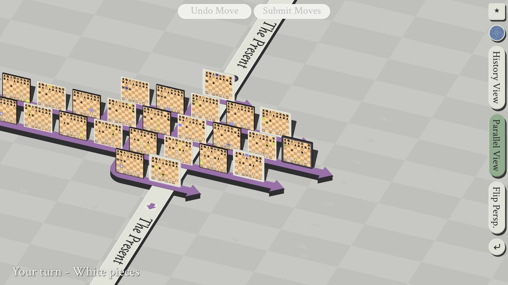
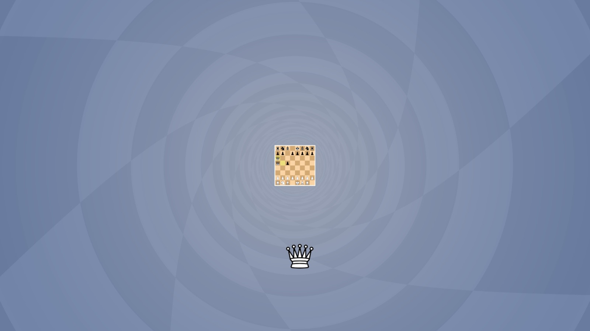
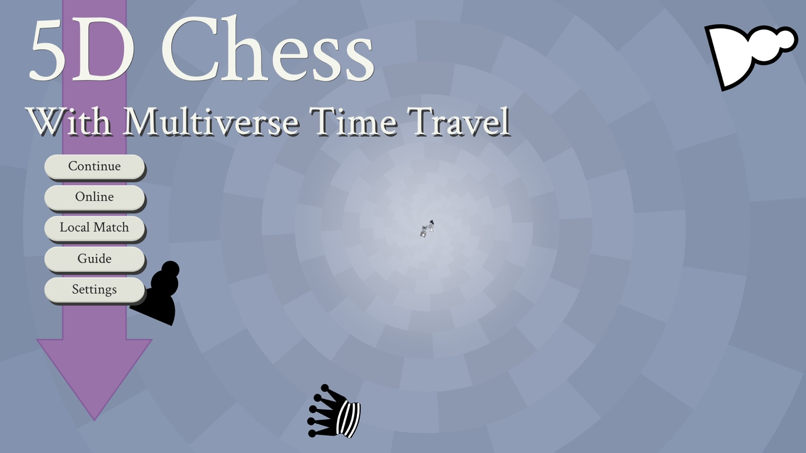

# 5dchess

Chess, except your knight can travel back in time and ambush a king who had no reason to be worried yet. Every trip to the past spawns a new timeline, so one polite game quickly becomes a multiverse of increasingly bad decisions. Play online by sharing a code or locally against your own past self, and check the in-game Guide for the full rules, which it explains far more calmly than you will feel.

**Play it now: https://5dimensionalchess.vercel.app**

| History View | Parallel View |
|---|---|
|  |  |

| Sending a queen back in time | The main menu |
|---|---|
|  |  |
