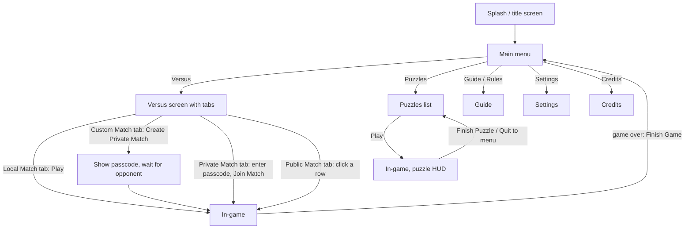

# UI / UX spec: "5D Chess With Multiverse Time Travel" (Thunkspace, 2020) reference

This is the reference for the app-shell / HUD developer. It describes how the **original** game looks and behaves so the web
replica can match it. It covers **only the parts of the original that map onto our app**:

- **Online multiplayer with a shareable game code** (our primary mode). The original's "Private Match" with a 6-piece passcode is the closest equivalent, and "Custom Match" / "Public Match" are the surrounding flows.
- **Local play in one browser** (one person moves both sides). The original calls this "Local Match" (named "Practice" at launch).
- Variant selection, time controls, settings, puzzles and the rules/guide.

> The original's **CPU Match** (four AI opponents) is **out of scope**. We are not building a computer opponent.

## Evidence levels

- **[C] Confirmed**: seen directly in game footage or screenshots (frame or timestamp cited), stated in official material (Steam store page or announcements, press kit), or stated consistently by well-established community references (Steam guide 2176513845, the 5D Chess fandom wiki, Patashu's archived puzzle guide).
- **[I] Inferred**: my reading of footage where the behaviour isn't shown unambiguously, or a reasonable design guess. Treat it as a default you may change.
- **[B] Unconfirmed (blog only)**: rests only on `docs/reference-blog.md`, the owner's fan blog. That blog is a secondary source and may contain mistakes. Where I could check one of its claims against footage, I say whether the footage confirms or refutes it.

### Sources and abbreviations used below

| Tag | Source |
|---|---|
| SG | Steam guide "A Guide on Pieces Moving Through Time and Timelines" (id 2176513845), text in `.../scratchpad/steam.txt`, screenshots in `.../scratchpad/steam_imgs/NN.png` (1080p game captures) |
| STORE | Steam store page and appdetails API for app 1349230; 9 screenshots saved as `research_imgs/store_ss_0N.jpg` |
| NEWS | All 6 official Steam announcements (2020-07-22 to 2021-11-04), text in `.../scratchpad/web/news.txt` |
| PK | Official press kit, https://www.5dchesswithmultiversetimetravel.com/presskit.html (media saved as `research_imgs/presskit_*`) |
| TRAILER | Official store trailer (44 s, 1080p), frames in `.../scratchpad/trailer/f/` |
| NL | Northernlion, "What Is Even Happening? 5D Chess…" https://www.youtube.com/watch?v=tWj3VBgf3b4 (2020-07-23, launch build) |
| HK | GMHikaru, "Hikaru Plays 5D Chess For The First Time" https://www.youtube.com/watch?v=v2zg-66eTY8 (Aug 2020) |
| TS | Triple S Games, "How to play 5D Chess…" https://www.youtube.com/watch?v=OL73o48db7s |
| RT | RTGame, "We Tried To Play 5D Chess" https://www.youtube.com/watch?v=suRtn-Jymzg (post-Oct-2020 build, has Guide) |
| BR | BrodieOnGames stream https://www.youtube.com/watch?v=IsNV3yA2e7w (online Private and Custom match, time-travel animation) |
| ON | profRI17, online match vs a stranger https://www.youtube.com/watch?v=iw_ISg-G7RQ (2020-08-28, Public Match) |
| TY | Tyyros https://www.youtube.com/watch?v=rJhMMAihUSA (2021-08, Settings v1.1.0.0e, Private Match) |
| JD | Jdebruez987 https://www.youtube.com/watch?v=DaoQ2Xdz0RE (Local Match with clocks) |
| JW | Jownology https://www.youtube.com/watch?v=uC85WFZPxVw (launch build, Rules screen) |
| CJ | "dom versus CoachJohn 5/19/2021" https://www.youtube.com/watch?v=BkjnWElbWYw (online with clock) |
| AE | Aeracs, "UPDATED FULL PUZZLE GUIDE" https://www.youtube.com/watch?v=vCYnrQdcaTU (2021-02, all 49 puzzles) |
| FW | 5D Chess fandom wiki, https://5d-chess.fandom.com (Tutorial, Variants pages) |
| TVT | TV Tropes page, via search snippets only (the site returns 403 to direct fetches) |
| BLOG | `docs/reference-blog.md` (owner's fan blog; secondary source) |

`research_imgs/` means `/private/tmp/claude-501/-Users-adam-Developer-5dchess/ae27d991-25b5-4a79-a803-8118136ecf9f/scratchpad/research_imgs/`.
Every image named below was viewed while writing this doc.

### Version notes [C]

- **Launch build, July 2020** (NL, JW, HK). Main menu: Versus / Puzzles / **Rules** / Settings / Credits / Exit. Versus tabs at the very first build: **Practice** / CPU / Public Match / Custom Match / Private Match (NL 12:01). These were soon renamed to Local Match / CPU Match / … (JW, HK). There were no clocks, and the puzzle counter read "Completed: 0/34".
- **2020-09-18 patch** (NEWS): Mac and Linux builds, "Colorblind mode for r/g blindness", "Some changes clarifying the purpose of various UI elements", and new variants.
- **2020-10-07 "Feature and Content Update"** (NEWS): "Big changes to the in-game guide" (the **Rules** button became **Guide**), "New time controls (clocks) for competitive matches", "a new splash screen", and 14 more puzzles, bringing the total to **49**.
- **2021-11-04**: tiny bugfix ("It is no longer possible to submit certain illegal moves by clicking them really fast").
- **Target this final build**: Settings shows "Version 1.1.0.0e-7-15" (TY 0:12). See `research_imgs/settings_panel_zoom.png`.

---

## 1. Global look

### 1.1 Palette (sampled from 1080p captures with Python/PIL; [C] for the measured values)

**Measurement method.** I took the most-common pixel colour in a box of each element. I sampled SG 04/05/06 (1080p), STORE screenshots, and PK and TRAILER frames. Values from 360p YouTube frames are marked ~ because compression shifts them by a few units.

| Token | Hex | Where measured |
|---|---|---|
| `bg-check-a` / `bg-check-b` | `#C0C0BB` / `#C8C8C3` | In-game background: a very large, low-contrast checkerboard (SG 04, 06) |
| `bg-puzzle-a` / `bg-puzzle-b` | `#B6C1B2` / `#BDC8B9` | Same checker, sage-green tint, in puzzle mode (AE, NL puzzle) |
| `bg-ended` | ~`#A19E96`/`#A7A49C` (warm) or ~`#9CA1AB`/`#A1A7AF` (cool) | Background darkens when the game or puzzle is over (NL 21:45, AE 2:26, RT 4:12) [C darkening; I exact tint] |
| `ui-fill` | `#E1E2D8` | Pills, tabs, panels, the present band when white is to move, light circles |
| `ui-fill-hi` | `#F4F5ED` | Text highlight and white-board frame, title text |
| `ui-row-a` / `ui-row-b` | `#EBECE3` / `#DDDED2` | Alternating rows in menu lists (PK 2020_07_08_0) |
| `ui-row-selected` | `#94B190` | Selected list row (PK); the same green appears on active toggles |
| `ink` | `#272727` | Button and tab text, icons |
| `shadow` | `#383838` | Hard drop shadow under every pill, tab, board and title (no blur) |
| `ink-dark-ui` | `#40404A` | Present band and circles when **black** is to move (STORE 05, TRAILER 0:05) |
| `square-light` / `square-dark` | `#FAD4A4` / `#D3A973` | Board squares (SG 04, 11) |
| `square-light-faded` | `#FDEBD7` | Light square on a faded (opponent-colour) board while a piece is selected (SG 04) |
| `frame-white` | `#F4F5ED` (inner `#E7E8E1`) | Frame of a board where **white** is to move |
| `frame-black` | `#383838` / `#272727` | Frame of a board where **black** is to move |
| `timeline-purple` | `#9971A9` (darker side `#845D9C`) | Timeline bars, big "future" arrow at the end of each timeline, main-menu arrow (`#9972A9`) |
| `hl-yellow` | `#DCCE60` (board frame `#C8B63D`) | Last-move squares on a board; frame of a board you've moved on this turn |
| `hl-blue` | `#9E99E2` / `#8C88DB` | Time-travel departure/arrival squares (SG 11, 12); frame of boards created by travel this turn; travel arrows |
| `arrow-travel` | `#8C88DB` with an edge of `#756ADE` | Curved arrows for cross-board moves (SG 06, 38) |
| `hl-green-light` / `hl-green-dark` | `#95AA6A` / `#859C60` | Legal-destination squares on light and dark squares (SG 13, 14) |
| `float-btn-green` | `#8FAD8C` (icon `#272727`) | Floating view shortcut on the selected board (SG 04) |
| `check-red` | `#D46B54` arrow; `#D46950` board frame | Check / illegal state (SG 38, 40; TS 0:54) |
| `btn-undo-yellow` | ~`#DCCE5F` | Undo button after a normal move (TS 0:48, AE 0:41) |
| `btn-undo-blue` | `#8C88DB` | Undo button after a time-travel move (SG 06) |
| `btn-undo-red` | ~`#D46851` | Undo button while the tentative position is illegal (TS 0:54) |
| `btn-deselect` | `#E7C08E` (lower lip `#CDA169`) | "Deselect" pill while a piece is selected (SG 04) |
| `btn-disabled` | fill `#F1F1EC`, text `#BCBCBC` | Disabled "Submit Moves" (SG 04, 06) |
| `btn-green` | ~`#91AC8E` | Hover/active green on pills and tabs (e.g. Submit hovered, active History View tab: RT 3:49) |
| `btn-dark` | ~`#3D4048` with light text | "Reset Puzzle" / "Finish Game" pills in some states (AE 0:41, RT 4:10) |
| `menu-bg-edge` / `menu-bg-center` | `#7D8EAC`–`#8093B3` / `#A5ACBE` | Blue-grey vortex behind all menus (STORE 09) |
| `menu-tab` | ~`#8294B3` | Menu tab buttons seen through the panel edge (PK) |
| `clock-bg` / `clock-active` | ~`#424152` / ~`#9471BF` | Clock widget (CJ) |
| `badge-red` | ~`#D0674D` | Red "!" badge on the board corner (TRAILER 0:34; AE puzzle-complete frames) |

**Colourblind mode (Deuteranopia)** exists as a setting (TY Settings; NEWS 2020-09-18). I have no capture of it, so its exact palette is unknown. [I] Swap the red/green pairs (check red vs legal-move green) for a blue/orange pair.

### 1.2 Typography

- **UI font** [I]. It is a classical old-style serif (Garamond-like) everywhere: menus, HUD pills, status text, the "The Present" lettering and the rules text.
  - The official site and press kit load **Crimson Text 400/600** from Google Fonts (`presskit.html` CSS). This is the most likely match, but it isn't confirmed from the game files.
  - EB Garamond is a close substitute.
  - Use **Crimson Text** with fallback `'EB Garamond', Garamond, Georgia, serif`.
- **"The Present" band lettering** [C]. Large *italic* serif text runs along the band, e.g. "The Present" (SG 01, 05).
- **Clock digits** [C]. These use a plain sans-serif, not the serif (CJ: "W 20:00+5"). [I] Use a tabular sans (e.g. `ui-monospace` or DejaVu Sans Mono).
- **Sizes at 1080p** (measured on SG 04/06):
  - Status text (bottom-left): cap height ~26 px, about **40 px font**, ~3.7 vh.
  - HUD pill labels: ~30 px.
  - Vertical tab labels: ~28 px.
  - Main-menu title "5D Chess": ~110 px; subtitle "With Multiverse Time Travel": ~55 px; menu buttons: ~22 px (STORE 09).

### 1.3 Shapes

- **Shadows** [C]. Everything is flat with a hard, unblurred dark drop shadow (`#383838`), offset down-right by about 6–8 px at 1080p. This applies to pills, tabs, boards (a big dark slab under each board), the timeline bars ("raised track"), menu buttons and the title text.
- **Pills** [C]. Fully rounded capsules with an ~8 px shadow lip under the bottom edge.
  - The top HUD pills are about 275×55 px at 1080p.
  - "Undo Move"/"Deselect" sits at x≈680–955 and "Submit Moves" at x≈965–1240, both centred at the top with y≈15–70 (SG 04/06).
- **Boards** [C]. Rounded-corner frames about 12 px thick in the board's turn colour, over a darker slab shadow.
  - Boards are laid out on a grid: time runs left→right, timelines run up/down.
  - Consecutive boards in a timeline are joined by a short purple bar segment. The last board of each timeline ends in a large purple arrow pointing right (the future).
- **Vertical tabs** [C]. They are glued to the right screen edge, about 60 px wide, with rounded left ends, and rotated text reading top→bottom.

---

## 2. App flow (scoped)



[C] for the screens and buttons listed. [I] for exactly where "Finish Game" returns to: footage cuts. Return to the Versus screen on the tab you came from.

### 2.1 Main menu [C]

References: STORE 09 (1080p, `research_imgs/store_ss_09.jpg`), `research_imgs/menu_main_v1.1_360p.png`, `research_imgs/menu_main_launch_rules_button_360p.png`.

- **Background**. A blue-grey "tunnel": concentric rings of a skewed checker pattern receding to a pale centre.
  - Cartoon chess-piece silhouettes (white with black outlines, and black) fly out of the centre towards the camera, growing and rotating, then leave the screen.
  - The same vortex is used behind every menu and during the time-travel animation (§5.3).
- **Title**. "5D Chess" (very large) over "With Multiverse Time Travel", top-left, in `#F4F5ED` with a hard dark shadow.
- **Buttons** (small light pills, stacked top-to-bottom at the left): **Versus**, **Puzzles**, **Guide** (labelled **Rules** in the launch build), **Settings**, **Credits**, **Exit**.
  - A huge translucent purple downward arrow sits behind the stack. It runs from the top of the screen to below the last button (logo motif; PK `logo_with_arrow`).
  - Hover highlights the pill green (BR 7:12 "Versus" green).
- **For the web**: drop **Exit**. We keep Versus (rename the tabs, see §2.2), Puzzles, Guide, Settings and Credits.

### 2.2 Versus screen [C]

The title at the top-left reads "Versus - <Tab Name>", e.g. "Versus - Local Match". There is a square **X** close button at the top-right. Under the title is a row of tab pills; the selected tab is drawn slightly lower and lighter.

Original tabs: **Local Match | CPU Match | Public Match | Custom Match | Private Match**. All content sits in one big rounded `#E1E2D8` panel.

**Local Match** (JD 0:54, `research_imgs/versus_local_match_360p.png`, BR 8:01)
- "Select time control:" with radios **No Clock (recommended)** · **Short Clock** · **Medium Clock** · **Long Clock**.
- "Select variant:" with a scrolling list (alternating row shades, selected row green, round scroll knob on the right).
- **Play** button, centred at the bottom.

**Custom Match**: creates an online game (BR 8:08–8:23, `research_imgs/versus_custom_match_360p.png`)
- "Select color:" with **Random** · **White** · **Black**.
- "Select time control:" with **No Clock (recommended)** · **Short (10+3/L)** · **Medium (20+5/L)** · **Long (40+8/L)**.
- "Select variant:" list.
- Two buttons: **Create Public Match** and **Create Private Match**.

**Private Match**: join by code (TY 11:52, BR 8:06–9:40; `research_imgs/versus_private_match_360p.png`, `research_imgs/private_match_passcode_entered_360p.png`)
- "Enter your passcode:" with **six empty square slots**.
- Below the slots, a 12-key "keypad" of round piece buttons: the white row ♙♘♗♖♕♔ plus a small **X** (backspace), and the black row ♟♞♝♜♛♚.
- Clicking a piece fills the next slot with that glyph. **Join Match** stays disabled (greyed) until all six are filled, then turns green on hover.
- The passcode is therefore **6 symbols from a 12-letter alphabet** (12⁶ ≈ 3 million codes).
  - [I] Creating a private match shows the creator this 6-piece code to share. I have no capture of the creator's waiting screen.
  - **For our app**: keep the piece-glyph code. It is charming and faithful. Also offer a plain URL with an encoded code (e.g. `?g=PQpRQn`), and add "Copy link".

**Public Match**: lobby (ON 0:00–1:30, `research_imgs/versus_public_match_list_360p.png`, `research_imgs/versus_public_match_waiting_360p.png`)
- A list of rows. Default rows offer "Variant: Standard / You play as: Random" and "Variant: Random / You play as: Random", each with italic "*Click to create*" at the right.
- After clicking, your row turns purple: "*This is your match* / Variant: Standard / You play as: Random … *Click to cancel*".
- When an opponent joins, the game starts directly. [I] Other players' open matches presumably appear as rows with "Click to join".
- NEWS mentions the game getting stuck "Looking..." in some conditions, so a "Looking..." state text exists. [I] Show it while matchmaking.
- Public matchmaking is not in our scope. Our equivalent is just "Create game, share code".

**CPU Match**: out of scope. For completeness: color, AI (Trainer (weak) / Regular / Balanced (strong) / Aggressive (strong)) and variant list, then Play. See `research_imgs/versus_cpu_match_outofscope_360p.png`.

**Suggested tab set for our app** (my recommendation, not from the original): **Online Match** (create: colour + time control + variant, then "Create Match" shows the code) | **Join Match** (6-glyph keypad / paste link) | **Local Match** (time control + variant, then Play).

### 2.3 Variant list [C]

The in-game list is one flat list of "Category - Name" strings (no tree). Standard and Random come first (JD 0:54, BR 8:13–8:23, FW Variants page). Order seen in the Local Match list:

```
Standard
Random
Simple - No Bishops
Simple - No Knights
Simple - No Rooks
Simple - No Queens
Simple - Knights vs. Bishops
Simple - Simple Set
Small            (= "Small - Default")
Small - Centered
Small - Flipped
Small - Open
Very Small
Very Small - Open
Misc - Timeline Invasion
Misc - Timeline Formations
…
```

The rest of the list is known from FW, but its exact in-game order after "Misc" is not fully seen:
- Misc - Timeline Battleground / Fragments / Marauders / Skirmish / Strategos / Tactician
- Misc - Excessive / Global Warming / King of Kings / Royal Queen Showdown
- Focused - Just Bishops / Brawns / Dragons / Kings / Knights / Pawns / Queens / Rooks / Unicorns
- Standard - Defended Pawn / Half Reflected / Princess / Reversed Royalty / Turn Zero / Two Timelines
- Checkmate Practice - Bishop / Knight / Pawns / Queen / Rook

Notes:
- 5DFEN for most of these is on the FW Variants page and in `adri326/5dchess-variants`.
- "Random" picks a random variant. [I] Picking "Random" for colour picks a random side.
- In the CPU list the game prefixed three entries with italic "*Recommended* - " (Standard, Simple - No Bishops, Misc - Timeline Invasion) at the top (JD 1:12). [I] We can reuse this "Recommended" prefix idea for new players in the online list.
- Board sizes range from 3×3 (Just Kings) to 8×8. 8×8 is the largest.

### 2.4 Time controls [C]

- Presets: **No Clock (recommended)**, **Short (10+3/L)**, **Medium (20+5/L)**, **Long (40+8/L)** (BR 8:08 radio labels; TVT).
  - In the Local Match tab the labels are shortened to "Short Clock / Medium Clock / Long Clock" (JD).
- **Meaning**: "20+5/L" is 20 minutes of main time plus a **delay** (not an increment) of 5 s **per active timeline** at the start of each turn.
  - The delay counts down first. Only then does main time run, and unused delay is lost.
  - Sources: Steam thread "What does the L mean in the clock options?" (L = timeline, "[remaining time] + [3 * 4]" with 4 timelines on Short); TVT.
- **Clock widget** (CJ 1:00, 2:20; `.../scratchpad/tmpimg/clock_zoom.png`):
  - Position: the **top-left corner**, a small dark rounded panel (`#424152`, dark border).
  - The word "Clocks" is written vertically on its left edge.
  - Two rows: `W   20:00+5` and `B   19:54`. The side to move has its row filled purple (`#9471BF`).
  - The "+N" suffix shows the remaining delay for the current turn, counting down. When it reaches 0 it disappears and the main time starts ticking (CJ: `18:45+2` → `19:54` without suffix).
- **Running out of time** [I]: the player whose clock hits zero loses ("by time"). I have no capture of the timeout banner. Reuse the game-over strings in §6.

### 2.5 Settings [C]

Opened from the main menu. A small centred panel (TY 0:12; `research_imgs/settings_panel_zoom.png`), top to bottom:

```
[✓] Enable sound        ───●───   (volume slider)
[✓] Enable music        ───●───
[✓] Enable ambience     ───●───
[ ] Fullscreen (F11)
Reset completion:  [Puzzles] [Guide]
[✓] Auto perspective flip
[ ] Colorblind Mode (Deuteranopia)
        Version 1.1.0.0e-7-15
```

- Checkboxes are square with a hard shadow and a hand-drawn ✓.
- Sliders are thin tracks with a round knob.
- Defaults as shown: sound, music, ambience and auto-flip on; fullscreen and colourblind off.

### 2.6 Guide / Rules (the original's tutorial) [C]

The original has **no interactive tutorial**. Teaching is done by (a) a written rules/guide screen and (b) the puzzle set. Reviewers complained about this, e.g. the Save or Quit review: "the game itself literally only has a text file for rules".

**Launch build, "Rules" screen** (JW 0:12–0:18, HK 12:08–12:18; `research_imgs/rules_screen_launch_360p.png`). A scrolling text panel titled "Rules", transcribed from 360p:
- **Quick Rules:**
  1. Most of the rules are the same as ordinary chess.
  2. Your pieces can move through time and between timelines just like they move along rows and columns.
  3. The past cannot be changed. Moving a piece to the past causes a new timeline to be created.
  4. To complete a turn, make moves until The Present shifts to your opponent.
  5. If you cannot complete your turn without leaving one of your king's attacked, you're checkmated (or stalemated).
- Then: "Go try a match vs the trainer CPU. You can start with a simplified board configuration. Revisit these rules once you have a little bit of context. Ask questions, share tricks, and find people to play with on the official Discord:" followed by a **[Copy Discord link to clipboard.]** button.
- **Strategy Tips:**
  - "Attacking a king's past is easier than attacking its present. History cannot be altered to change where the king was or to allow another piece to block the attack. The attacker must be captured!"
  - "If you're in check on one timeline, your only option may be to time travel very far backwards from another timeline."
  - "If a player branches twice before their opponent branches once, the extra timeline will be inactive and won't affect The Present…"
- **Complete Rules and Justification:** "The rules of 5D Chess with Multiverse Time Travel are generalized from the rules of ordinary chess. The 5D in the name refers to the typical two spatial dimensions, a third unused spatial dimension, a fourth dimension representing time, and a fifth dimension representing parallel timelines…"
  - Subjects: "1) What is checkmate? 2) How are a piece's available moves determined? 3) What happens when a piece travels to the past? 4) Who's turn is it, and on which timelines must they move?"
  - Section 1 begins: "If a player has no way to end their turn (no way to move The Present without leaving themselves in check), then they are checkmated (or stalemated)… A move that attacks a king's past is a valid check…"

**Post-Oct-2020 "Guide"** (RT 3:55; `research_imgs/guide_timelines_360p.png`)
- The guide is split into titled pages, e.g. **"Guide - Timelines"**, each a big rounded text panel with centred section headings such as "Turns and Timelines".
- Pages contain inline diagrams/icons; the purple up-arrow present indicator is drawn inline.
- Text seen:
  - "1) Who's turn is it? A player makes moves while it is their turn in The Present. To complete their turn, a player must make moves until The Present shifts to their opponent. This can be done by taking action on multiple boards until The Present advances, or by creating a timeline in the past that rewinds The Present."
  - "2) Which timelines must be played? A player can ignore any timelines that are not needed to advance or rewind The Present. If a player branches twice before their opponent branches once, the extra branches will be inactive, and won't affect The Present until their opponent makes more branches. You can tell whether your next branch will be active by looking for a purple arrow indicator on The Present."
  - "3) How are timelines created? If a piece moves to a board where a move has already occured, a new timeline branch is created because history cannot be altered. The latest move on the new timeline is the time travelling piece's …"
- Settings has "Reset completion: Guide", so guide pages track completion.
- The guide also covers the new pieces ("read about them in the in-game guide!", NEWS 2020-10-07).
- [I] I did not capture the guide's index. Model it as a list of pages: basics, pieces (incl. Unicorn, Dragon, Princess, Brawn), timelines, present, check/checkmate, notation.

### 2.7 Credits [C via TVT snippet only, otherwise I]

According to TVT, the credits have sections including "Additional Thanks" and "Community Contributions" (MariAurum listed first) and end with "Thanks for Playing!". PK: "Chess Pieces by Colin M.L. Burnett and others / BSD License". The piece art is the Cburnett set (Wikimedia), licensed BSD/GPL.

---

## 3. In-game screen layout

Reference captures: `research_imgs/hud_reference_1080p_steamguide04.png` (= SG 04), SG 05/06/07, `research_imgs/store_ss_05.jpg`.

```
┌────────────────────────────────────────────────────────────────────────┐
│ [Clocks W 20:00+5 ]      ( Undo Move )( Submit Moves )( Reset Puzzle ) [*]│
│ [       B 19:54   ]                                                     (○)│
│                                                                         │H│
│      ▮board▮━▮board▮━▮board▮━━━━▶      ║  The   ║                         │i│
│                                        ║Present ║                        │s│
│      ▮board▮━▮board▮━━━━━━━━━━━━━━━━▶  ║ (band) ║                         │P│
│                                                                         │a│
│                                                                         │F│
│ Your turn - White pieces                                               (↵)│
└────────────────────────────────────────────────────────────────────────┘
```

### 3.1 Top-centre pills [C]

- **Left pill**
  - Nothing selected and nothing moved: **"Undo Move"**, disabled (`#F1F1EC`/`#BCBCBC`) (TS 0:24).
  - A piece is selected: **"Deselect" + a small glyph of the selected piece** (e.g. "Deselect♛"), tan/orange `#E7C08E` (SG 04, 05; TS 0:30).
  - After at least one tentative move: **"Undo Move"**, enabled, tinted by the last action. Yellow `#DCCE5F` after an ordinary move (TS 0:48); blue/purple `#8C88DB` after a move that created a board by time travel or moved between boards (SG 06, 07, NL 13:44); red `#D46851` when the current tentative position leaves you in check (TS 0:54).
- **Middle pill**
  - **"Submit Moves"**: disabled until the present has shifted to the opponent (§4.4).
  - Enabled: light fill with dark text, green `#91AC8E` on hover (TS 0:48, BR 12:58).
  - After the game ends it becomes **"Finish Game"** (dark pill, light text) (RT 4:10; NL 21:45).
  - In puzzles, after the mate is delivered it becomes **"Finish Puzzle"** (AE 2:26, 5:02).
- **Right pill (puzzles only)**: **"Reset Puzzle"**. Hotkey R. Disabled/greyed until you've moved (AE 0:25 vs 0:41).
- [C] These pills are centred horizontally. They're a little left of centre when the Reset pill is present (the group stays centred).

### 3.2 Right-edge column (top to bottom) [C]

All of these appear in every in-game screenshot (SG 04–07, TS, NL, AE).

1. **[*]**: small square-ish pill with an asterisk. Opens the in-game menu panel (§3.5).
2. **Round checkered button**: a circle filled with a tiny checker pattern. SG: "This one enables/disables the animation for time-traveling." In footage it is shown filled (blue-grey) when the animation is on and hollow when off (TS 0:24 vs 0:54). [I] for which state is which; on is filled.
3. **"History View"**: vertical tab.
4. **"Parallel View"**: vertical tab.
5. **"Flip Persp."**: vertical tab.
6. **Round "↵"-like button** (a bent arrow): SG: "This one cycles through boards that you are able to play, hotkey is TAB."

Tab states:
- An active view tab is filled green (RT 3:49: "History View" green while History View is active).
- The cycle button is filled in the colour of the player to move: light in SG 06 (white to move), dark in SG 07 (black to move). [C] observed; [I] that this is the rule.

### 3.3 Bottom-left status text [C]

Large serif text with a dark shadow, at the bottom-left (SG 04: "Your turn - White pieces"). Exact strings seen:

| State | Text |
|---|---|
| Local game, white / black to move | `Your turn - White pieces` / `Your turn - Black pieces` (both sides say "Your turn" in local play) |
| Online, opponent to move | `Their turn - White pieces` / `Their turn - Black pieces` (ON 1:40, BR 10:46) |
| CPU thinking (out of scope) | `Thinking...` + small spinning diamond icon (NL 12:07) |
| Puzzle in progress | the puzzle's name, e.g. `Rook Tactics I ~ Mate-in-one` (AE) |
| Puzzle solved | `Puzzle complete!` on the line above the puzzle name (AE 2:26) |
| Game over | `You win!` or `You lose` on the line above `Game ended - Black wins` / `Game ended - White wins` (RT 4:10; NL 21:45) |

- [I] Local game over: there is no "you", so show just `Game ended - White wins`.
- [I] Draw/stalemate: `Game ended - Draw`. The patch note "Puzzle draws are no longer counted as wins" proves draws exist, but I have no screenshot.
- [I] Forfeit: same banner. The forfeit button exists (§3.5).
- **Check / illegal submit message**: there is **no text message** for check or for an illegal tentative position. It is shown purely visually (§4.6) [C: none seen in any capture].

### 3.4 Background labels [C]

- Very faint, large labels are drawn on the background checker.
- **"T1", "T2", …** along the bottom under each time column (SG 01, 06: "T1 T2 T3 T4").
- **"0L", "+1L", "-1L", …** at the right end of each timeline row (AE frames; BR 3D view shows "-1L"/"+1L").
- Text colour is just slightly darker than the background (about `bg` minus 10%).

### 3.5 In-game "*" menu panel [C]

A rounded `#E1E2D8` panel that drops down near the top-centre. While it is open the rest of the screen dims (NL 11:55 dims to dark). Captures: HK 11:58 `research_imgs/ingame_star_menu_hotkeys_zoom.png`, NL 11:55 `research_imgs/ingame_star_menu_autoflip_zoom.png`, NL puzzle `research_imgs/puzzle_star_menu_quit_zoom.png`.

```
[✓] Enable sound
[✓] Enable ambience
[✓] Auto perspective flip        ← only in Local/Practice games
( Forfeit game )                 ← versus games;  ( Quit to menu ) in puzzles
Hotkeys:
Select/Drop: L/R mouse
Undo: Backspace or Z
Submit: Enter or F
Reset puzzle: R
Cycle boards: Tab
Move: WASD or arrows
Zoom: EQ or scroll
Views: TY
Flip Perspective: U
```

- The online game menu (BR 11:52) shows only sound, ambience and **Forfeit game**. There is no auto-flip in online games, because the view is fixed to your colour.
- [I] "Forfeit game" ends the game immediately as a loss. Add a confirm step in our version: the original fires on one click as far as I can see.

### 3.6 No move list or notation panel [C]

There is **no notation, move list or chat panel** anywhere in the original UI (no capture shows one). History is entirely visual: every past board stays on screen with highlights and arrows. PK: "Every past move is visible at all times, with highlights and arrows to help you keep track of what has happened."

---

## 4. The board area

### 4.1 Before the first move [C]

TS 0:24 (`research_imgs/game_start_single_board_360p.png`), NL 4:50.

- One board sits in the middle of the screen, white's frame (light), white at the bottom.
- A purple timeline bar comes in from the left edge, fading out towards the left with a motion-blur look, into the board.
- A big purple arrow points right out of the board (the future).
- **The Present band** runs vertically through the board's column, light because white is to move.
  - A circle with a purple up-arrow sits on the band above the board, and a circle with a purple down-arrow sits below it (§4.3).
- "Undo Move" and "Submit Moves" are both disabled. Status: "Your turn - White pieces".
- BLOG ("Originally the game displays a single chessboard"): **confirmed**.

### 4.2 Tentative boards (after moving, before submitting) [C]

TS 0:48 (`research_imgs/tentative_board_after_first_move_360p.png`), SG 04, 06.

- Making a move on a playable board **does not change that board**. A **new board appears to its right**: a copy with the move applied, in the next turn's colour, framed **thick yellow** (`#C8B63D`/`#DCCE60`).
- The source board keeps its yellow from/to squares too.
- The Present band moves to the new column and changes colour (§4.4).
- Boards created by time travel or by moves between boards get a **blue/purple frame** (`#8C88DB`) instead of yellow (SG 06, 07; NL 13:44).
- Undo removes the last tentative board. After Submit the frames revert to normal white/black frames and the yellow/blue square highlights stay as history markers.
- BLOG ("After you make your first move, the resulting position is displayed on a separate chessboard to the right … not part of the game's active space yet because the turn is incomplete"): **confirmed**.

### 4.3 Present indicator [C]

- **The band.** A wide vertical band runs the full screen height through the **present column**, i.e. the earliest time at which some active timeline still needs a move.
  - It is drawn as a raised strip with a hard shadow, with "The Present" lettered along it in big italic serif (SG 01, 05, NL 13:39).
  - The fandom wiki: "The present is represented by a vertical bar, and is always at the earliest playable board among all active timelines."
  - SG: "All boards that rest on this bar needs to be played on your turn, UNLESS you move a piece back in time, which will also move the 'Present' back along with a new timeline."
- **Band colour = the player to move at the present**: light `#E1E2D8` when it is white's, dark `#40404A` when it is black's (sampled: SG 06 vs STORE 05 / TRAILER 0:05).
  - The colour updates live as you make tentative moves. When your moves have shifted the present to the opponent, the band turns the opponent's colour and **Submit Moves** enables. TS 0:48: after white's first move the band behind the new board is dark.
  - BLOG ("indicated by the large white/black arrow through the center of the screen"): **confirmed**, though it is a band, not an arrow.
- **The two markers on the band** (SG "The UI"): "two arrows pointing up and down on the 'Present'. These dictate where new timelines will show up, respect to their color."
  - Each marker is a **circle in one player's colour**. Seen as white: the dark (black's) circle sits at the **top** with an **up** arrow, and the light (white's) circle sits at the **bottom** with a **down** arrow. This is the direction in which that player's new timelines will appear.
  - Inside the circle there is a **purple arrow** if that player's next branch would be **active** (it would move the present). It is an **empty circle** if their next branch would be **inactive** (they are already one timeline ahead). Examples: SG 06 has the bottom circle empty after white branched; NL 13:44 has the bottom circle empty after white's queen travel.
  - Guide text: "You can tell whether your next branch will be active by looking for a purple arrow indicator on The Present."
- **Inactive timelines**: SG: "that new timeline will be marked with a white/black arrow underneath instead of the usual purple arrow". The end arrow of an inactive timeline is drawn in the creator's colour (light or dark) instead of purple. SG 06 shows a light arrow at the end of white's extra timeline; SG 07 shows a dark arrow. When it becomes active again it turns purple.
- **Camera tie-in** [C]: the camera follows the present horizontally (TS/NL: after submit, the view glides to keep the band near centre).

### 4.4 Perspective and timeline placement

- **Layout** [C]: time runs **left→right** (past to future). Timelines stack vertically. The original timeline is labelled "0L".
- **Own branches at the bottom** [C]: each player's new timelines appear **below** everything from their own point of view, and the opponent's appear **above**.
  - FW: "Branches are always created downwards from the view of the current player."
  - SG: the two Present markers point up and down by colour.
  - NL 13:44: white's queen travel creates its timeline **below** the main line as seen by white.
  - Numbering: white's timelines are +1, +2 … and black's are −1, −2 … (FW).
  - When viewing as white, +L rows are drawn below 0L. When viewing as black the whole picture is mirrored vertically (and every board is rotated 180°), so black's −L rows are drawn below.
  - BLOG ("whenever you create the next timeline, it appears at the lowermost part of the screen while whenever your opponent creates the next timeline … uppermost"): **confirmed**.
  - BLOG (NL ~13:07: white's queen travels back from the present to h5 on an earlier board, creating timeline +1 below the main line): **confirmed** by NL 13:09–13:44. The queen is selected, the History View shortcut is used, a past board glows green, and after the move a blue-framed board appears on a new row **below** with a purple-blue travel arrow. The exact squares and turn numbers the blog gives were not checked frame by frame, so they stay unconfirmed (blog only).
- **Flipping** [C]: **Flip Persp.** (hotkey U) flips the whole view: boards rotate 180° and the timeline stack mirrors top↔bottom.
- **Online: automatic and fixed to your colour** [C]: ON 1:40 shows a player who is black seeing black at the bottom ("Their turn - White pieces" with white's pieces at the top). The online "*" menu has no auto-flip option (BR 11:52).
- **Local / hotseat: controlled by "Auto perspective flip"** [C]. This is a setting (default **on**, Settings) and is also in the local game's "*" menu (NL practice). With it on, the view flips to the side to move after each Submit. NL 11:55 shows "Your turn - Black pieces" with the board flipped (white pieces at the top) in a Practice game.
  - [I] With it off, the view stays on white's side (manual U still works).
- **Puzzles**: the view is fixed to the solver's side. No auto-flip option in the puzzle menu (NL puzzle "*" menu). AE Rook Tactics IV is played as black and shown from black's side.

### 4.5 Selection, hover and highlights [C]

- **Selecting**: left-click one of your pieces on a playable board.
  - The left pill becomes "Deselect<glyph>".
  - Every legal destination square on every board turns **green**: `#95AA6A` on light squares, `#859C60` on dark (SG 04, 13, 14).
  - Boards **of the opponent's colour fade** to ~40% (washed-out squares `#FDEBD7`) so you can see which boards you can land on (SG 04 vs 06).
  - SG: "You cannot move a piece into a board with your opponent's color."
  - Destinations on past boards (time travel) and on other timelines are green too. NL 13:24: the whole target past board glows green on hover.
- **Clicking a green square** makes the move (tentative). "Select/Drop: L/R mouse": left selects/moves, and [I] right-click "drops", i.e. deselects. The Deselect pill also deselects.
- **Hover** [I]: hovering a green destination highlights it more strongly. In History/Parallel view, white arrows run from the piece to every destination (SG 05, 17–20, 34).
- **History highlights**, persistent after submit:
  - **Yellow** squares `#DCCE60`: from- and to-square of the last move made *on that board* (SG 10, 16; SG: "Yellow squares are pieces that have moved in their own boards recently").
  - **Blue** squares `#9E99E2`: departure and arrival of a time-travel or cross-board move. These replace yellow on both boards (SG 11, 12; SG: "Blue squares are points of time-travel departure and entry. They will replace any yellow squares at both boards").
  - **Purple-blue curved arrows** from origin to destination across boards for travel moves (SG 06, 07, 38). Same-board moves have no arrow, just yellow squares.
  - SG: "yellow and blue colors on the board borders are the same, they only show before you submit your move(s)". Board-frame yellow/blue appears only on tentative boards.
- **Floating view buttons on the selected board** (SG 04; NL 13:09). When a piece is selected, small rounded green buttons (`#8FAD8C`, dark icon) appear docked to the selected board's edges:
  - On the **left edge**: an icon of two upright panels = **History View** shortcut.
  - On the **top edge**: an icon of two stacked planes = **Parallel View** shortcut.
  - SG: "they have History and Parallel View buttons on the side for you to click on when you select a piece that is able to move through timelines."
  - In SG 04 the left one is grey (`#E1E2D8`) and the top one green. [I] Green means the piece has moves in that direction; grey means it doesn't.

### 4.6 Check, illegal positions and invalid submit [C]

- **Check arrows**: a **red arrow** (`#D46B54`) is drawn from each attacking piece to the attacked king, including across boards and into the past. The board containing the threatened king gets a **thick red frame** (`#D46950`) (SG 38, 40; TS 0:54; `research_imgs/invalid_submit_red_check_360p.png`).
- **Your tentative move leaves you in check**: the red arrow and red board frame appear immediately on the tentative position, **"Undo Move" turns red**, and **Submit Moves stays disabled**. You cannot submit an illegal turn; the only fix is Undo (TS 0:54).
- So there is no separate "invalid submit" error or dialog: Submit simply never enables. NEWS 2021-11-04 confirms that submitting illegal moves was a bug.
- **Red "!" badge** (`#D0674D`, round, top-right corner of a board): marks the board where a mate/check is delivered (TRAILER 0:34; AE puzzle-complete frames 2:26, 5:02, 10:40).
- **Green "!" badge**: shown on the decisive board at game end (RT 4:10).
- **Game over view**: the background darkens. The status shows "You win!"/"You lose" and "Game ended - <Colour> wins". The centre pill becomes "Finish Game". "Undo Move" can still be pressed; this shows the decisive capture: a red arrow into the king and a red board (RT 4:12–4:15, `research_imgs/game_end_winning_capture_shown_360p.png`). [I] It is a post-mortem preview that can't change the result.

### 4.7 History View and Parallel View [C]

- **Views** (hotkeys T/Y; tabs on the right; floating shortcuts). Both switch to an **isometric 3D camera**: boards stand upright like cards on raised tracks, and the floor checker is visible in perspective.
  - **History View**: tilted to look along **time**. The timelines become staircases receding into the past, so time-travel targets line up (SG 05, 17; RT 3:49; NL 13:14).
  - **Parallel View**: tilted to look **across timelines**, so cross-timeline targets line up (SG 24, 27, 34, 45).
- SG: "Clicking them will make your opponent's boards disappear and make it slightly better to understand." Opponent-colour boards hide; only boards of the mover's colour are shown.
- Legal moves are drawn as **white arrows** (`#F4F5ED`/white) from the selected piece to every destination.
- The active tab is green. Clicking it again (or the same hotkey) returns to the flat 2D view.
- "The Present" band is visible in 3D as a long strip on the floor.

---

## 5. Camera, input and animation

### 5.1 Controls [C, from the in-game hotkey list]

| Action | Original binding |
|---|---|
| Select / drop (deselect) | Left mouse / right mouse |
| Undo | Backspace or Z |
| Submit | Enter or F |
| Reset puzzle | R |
| Cycle playable boards | Tab (camera glides to the next board you still must or can move on) |
| Pan camera | W A S D or arrow keys |
| Zoom | E / Q or mouse scroll |
| Views | T (History View), Y (Parallel View) [I which key is which] |
| Flip perspective | U |
| Fullscreen | F11 |

[I] Mouse-drag panning: not listed in the hotkey list and not clearly visible in footage. Add drag-to-pan (left drag on empty space, or right/middle drag) because web users expect it.

### 5.2 Camera moves [C]

- Smooth eased glides, never cuts.
- After Submit the camera moves to keep the new present in view (TS, NL).
- Tab jumps the camera to the next playable board.
- Switching to History/Parallel view is an animated tilt and rotation into isometric (NL 13:09→13:14, RT 3:47→3:48).
- Flip Persp. animates a rotation (HK).
- At game start in BR 9:40→10:02 the camera zooms in on the single board.

### 5.3 Time-travel animation (toggle: round checkered button) [C]

Captured frame by frame in BR 12:47–12:58 (`research_imgs/time_travel_animation_sheet_a.png`, `..._b.png`). It plays when a piece is moved onto a past board. Total about 8–10 s:

1. The camera snaps from 3D to the flat view and pans along the source timeline (12:47–12:49).
2. The timeline's boards tilt and slide into a diagonal **stack of cards**. The scene crossfades to the **blue vortex background** used in the menus, and the stack collapses back through history to the **destination past board** (12:50–12:51).
3. On the vortex, the destination board pulses in and out of the distance while the **travelling piece** (shown large, outside the board) spirals towards it (12:52–12:57).
4. The piece lands. The view fades back to the game, zoomed close on the **new board**, which now sits on its new timeline row. Then it zooms out to the normal view (12:58–13:00).

Turning the toggle off skips this and just shows the new board (NL 13:39–13:44: the camera only pans).

[I] Our version should be ≤3 s and skippable by click, with the same beats: rewind cards, vortex, piece lands. Default **on** for the first few travels, as in the original.

### 5.4 Other animations [I unless noted]

- Pieces slide to their destination square.
- New tentative boards slide or pop in from the left neighbour.
- The present band slides horizontally and crossfades its colour.
- Menu pills nudge on hover.
- Menu screens crossfade (NL 11:37: the game fades to black, then the menu fades in, ~0.5 s) [C for the fade].

### 5.5 Audio

- [C] Settings has separate toggles and volume sliders for **sound** (SFX), **music** and **ambience** (TY 0:12). The in-game menu exposes sound and ambience (HK, NL).
- [C] The Save or Quit review says "the sound is totally open-source", and PK credits only the piece art. Assets are presumably CC0/CC-BY freesound-style clips; no attribution list was found.
- [I] SFX set. The AGPL remake Chess-in-5D, which mimics the original, ships `piece.flac`, `submit.flac`, `reverse.flac` (time travel), `end.flac` and `ambience.flac` (`.../scratchpad/ref/src/assets/sound/`). These are the cues to reproduce:
  - piece placed (soft wooden click);
  - turn submitted (chime);
  - time travel (reversed/whoosh sound under the animation);
  - game end;
  - a quiet looping ambient drone in game.
- [I] Menu music. A "music" track exists (setting); the menu is where it is most likely to play.
- Do not copy the remake's audio files (AGPL), and do not copy the original's.

---

## 6. Match start and end

**Local match** [C]
- Versus → Local Match → choose time control and variant → **Play**.
- The board appears with white to move, and both sides are played from this one screen.
- With Auto perspective flip on, the view flips after each Submit.

**Online, original flow** [C]
- Custom Match → colour, time control and variant → **Create Private Match** (or Create Public Match). The opponent goes to Private Match, types the six piece glyphs, and presses **Join Match** (BR 8:06–10:02).
- The game opens directly on the board, oriented to your colour. The status reads "Your turn" or "Their turn".
- During the opponent's turn you can still pan, zoom, select pieces and look at their moves, but you can't move. [I] There is no capture of trying to move during the opponent's turn.
- The opponent's submitted moves appear with the same highlights and arrows (yellow/blue/arrows) when they arrive. [I] The time-travel animation plays for their travel moves too.

**Game end** [C]
- On checkmate the background darkens and the status shows `You win!` / `You lose` + `Game ended - X wins`. The centre pill becomes **Finish Game**.
- Clicking it returns to the menu. [I] It returns to the Versus screen.
- There is **no rematch button** in the original [C: none in any end screen]. [I] For our app, add "Rematch (swap colours)" and "Back to menu" next to Finish Game, styled as the same pills.

**Forfeit**: "*" menu → **Forfeit game**. [I] The opponent sees `You win!` + `Game ended - X wins`.

**Puzzles**: Puzzles → choose → **Play**.
- The game opens with the puzzle's preset history already on screen. The status shows the puzzle name, and the pills read Undo/Deselect, Submit Moves and Reset Puzzle.
- The opponent's replies are automatic (puzzle AI, not deterministic: "Puzzle AI avoids a few blunders", NEWS).
- On mate: `Puzzle complete!` appears, a red ! badge marks the mated board, the background darkens, and the centre pill becomes **Finish Puzzle**, which returns to the list.
- Failing doesn't produce a banner. [I] You just run out of moves; use Reset Puzzle. Puzzle draws do not count as completion (NEWS 2020-07-24).
- See `docs/puzzles.md`.

---

## 7. Things the original lacks that we will need (not part of the replica; keep them in the same style)

- **Game code display, copy-link and waiting-for-opponent state** for online play. The original's code is 6 piece glyphs (§2.2). [I]
- **Reconnect / opponent-disconnected notice**: not observed in the original. Use bottom-left status text, e.g. `Opponent disconnected - waiting…`. [I]
- **Rematch** (§6). [I]
- **Forfeit confirmation**. [I]
- **Mobile/touch**: the original is mouse and keyboard only.
